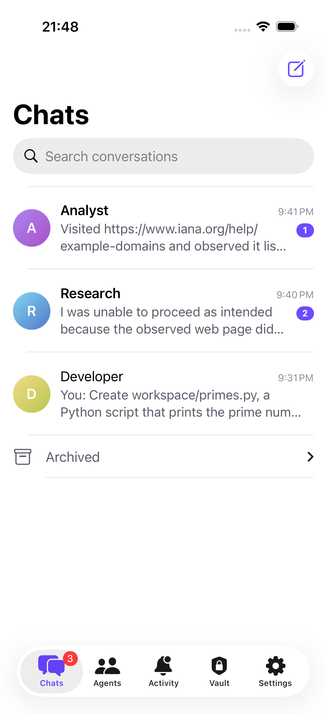
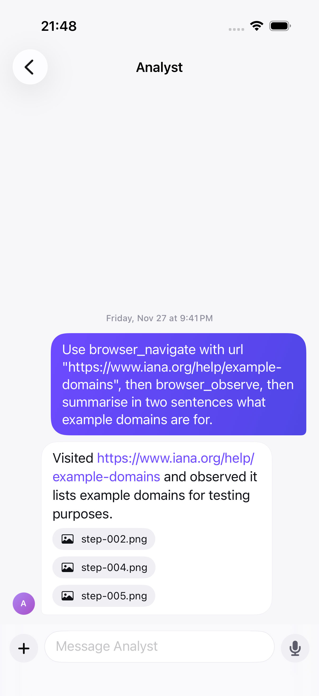
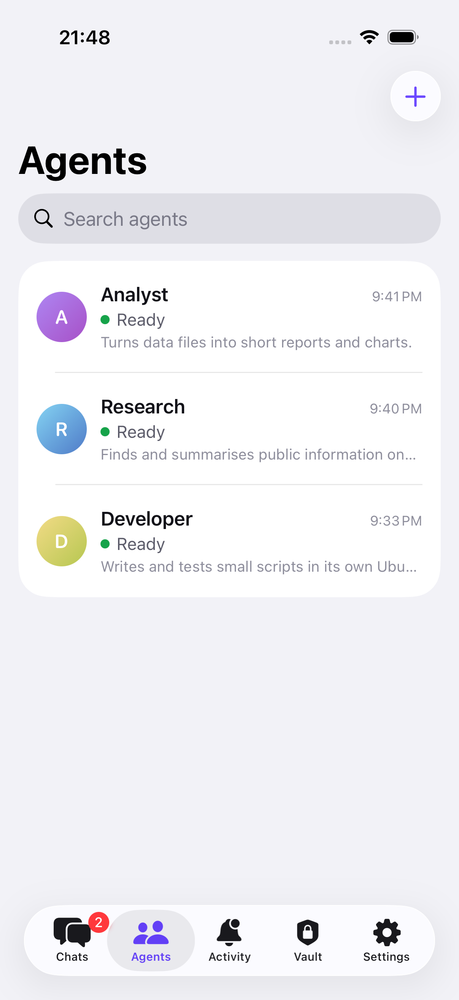
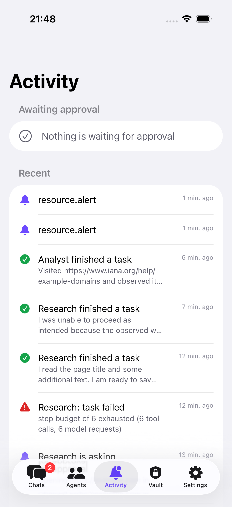

# NEBULA for iPhone and Mac

**Your Mac mini. Your AI agents. Your infrastructure.**

Native SwiftUI apps for iPhone, iPad and Mac that connect to your own [NEBULA](https://github.com/ond1ej/NEBULA_v1)
server. Chat with your agents, approve their sensitive actions with Face ID or Touch ID, answer their sign-in requests,
watch or take over an agent's desktop, and check on your Mac mini and its virtual machine.

> **These apps do nothing on their own. They need a NEBULA server.** NEBULA runs on a Mac (typically a Mac mini) from
> the [NEBULA_v1](https://github.com/ond1ej/NEBULA_v1) repository. Agents, tasks, the Password Vault and all data stay
> on that Mac. The apps are thin clients of its remote gateway. There is no NEBULA cloud service and no NEBULA account.

License: [MIT](LICENSE). Status: 1.0.0, built from source only (see [Limitations](#limitations)).

## Screenshots

The iPhone app on the iOS simulator, paired with a demo NEBULA server (synthetic tasks, a local model). The UI test
`testReadmeScreenshots` captures them.

| | | |
|---|---|---|
|  |  |  |
| **Chats** with each agent | **A conversation**: the agent's answer and its step screenshots | **Agents** and their state |
|  | | |
| **Activity**: approvals and notifications | | |

## Features

What the code in this repository does (the server decides what each paired device may do):

- **Chats.** Start and continue conversations with your agents, with streamed replies, Markdown and syntax-highlighted
  code. Attach photos and files, or record a voice note.
- **Agents and tasks.** List, create, edit and delete agents; pause, resume, put to sleep and wake them. Follow a
  task's steps and pause, resume, stop or retry it.
- **Activity.** Approvals waiting for you, recent notifications, and Smart sign-in requests. While the app runs it
  shows local notifications for important events; remote push is optional (see
  [docs/building.md](docs/building.md#push-notifications)).
- **Approvals with Face ID or Touch ID.** Sensitive actions (approving an agent action, revealing a password,
  deleting an agent, stopping the VM) are confirmed on the device. The server checks a signature made by a device key
  that only works after biometric confirmation, so a stolen session token alone is not enough.
- **Password Vault and Smart sign-in.** When an agent needs to sign in somewhere, you answer in a secure form
  (password, code or approval) and the agent never sees the secret. A revealed password copied to the clipboard is
  removed after 60 seconds and is not shared through Universal Clipboard.
- **Live Desktop.** Watch an agent's desktop in real time (a VNC/RFB client built into the app) and take over mouse and
  keyboard when you need to, then hand control back.
- **System.** Status of the Mac and the VM, start or stop the VM, restart services, back up the database,
  diagnostics and paired devices.
- **App lock.** Optionally require Face ID or Touch ID every time the app opens.
- **Two native apps.** The iPhone/iPad app uses a tab bar; the Mac app uses a sidebar, an inspector and a separate
  Live Desktop window. Both share one Swift package, `NEBULAKit`.
- **Languages.** English (base) and Czech.

## Requirements

- A running **NEBULA server** ([NEBULA_v1](https://github.com/ond1ej/NEBULA_v1)) on a Mac, with its remote gateway
  reachable over HTTPS (Tailscale Serve is recommended, see [docs/using.md](docs/using.md#reaching-your-server)).
- A Mac with **Xcode 26 or later** to build the apps. The project uses Swift 6 and some iOS 26 / macOS 26 APIs behind
  availability checks, so it needs the iOS 26 and macOS 26 SDKs.
- Devices: **iOS 18 or later** (iPhone, iPad) and **macOS 15 or later**.
- For a real iPhone: an Apple ID in Xcode. A free Apple ID works; remote push notifications need the paid Apple
  Developer Program.

## Build

```bash
git clone https://github.com/ond1ej/NEBULA-iOS.git
cd NEBULA-iOS
open NEBULA.xcodeproj
```

Choose the **NEBULA iOS** scheme and an iPhone simulator, or **NEBULA Mac** and "My Mac", and press Run. With the
committed defaults you need no Apple account for the simulator or for running the Mac app locally.

To run on your own iPhone, put your Team ID and a bundle-identifier prefix in the git-ignored `Config/Local.xcconfig`:

```bash
cp Config/Local.xcconfig.example Config/Local.xcconfig
# edit DEVELOPMENT_TEAM and NEBULA_BUNDLE_ID_PREFIX
```

Command-line builds, signing options, push notifications and tests are described in
**[docs/building.md](docs/building.md)**.

## Pair with your server

1. On the Mac that runs NEBULA, open the Dashboard, go to the **Devices** page and click **Pair an iPhone or Mac**.
2. In the app, tap **Scan QR code** or paste the `nebula://pair?...` link, and confirm with Face ID or Touch ID.
3. Compare the six-digit code in the app with the one in the Dashboard and approve the device there.

Details, remote access and troubleshooting: **[docs/using.md](docs/using.md)**.

## Security notes

- **Device keys in the Secure Enclave.** Pairing creates an identity key (for signing in) and a confirmation key that
  only Face ID, Touch ID or the device passcode can unlock. On devices with a Secure Enclave the private keys never
  leave it. The simulator and a Mac build signed "to run locally" cannot use it; the app says which protection is in
  use.
- **You enter the server address.** The app has no built-in server. The gateway address comes only from the pairing
  link that your own Dashboard creates. The link also carries the fingerprint of your server's key, and the app
  refuses a server that cannot prove it holds that key.
- **No hard-coded hosts.** The apps contain no NEBULA host names, no analytics and no third-party services. Release
  builds accept only `https://` gateway addresses; Debug builds also accept plain `http://` on loopback, for a local
  test server.
- **Secrets stay on the device or the server.** Session tokens and the device secret are kept in the Keychain, for
  this device only. Passwords from the vault are shown only after a biometric confirmation.
- **Revocation.** Removing a device in the Dashboard ends its sessions immediately.

Please report vulnerabilities privately, see [SECURITY.md](SECURITY.md).

## Limitations

- **No App Store, TestFlight or notarized build is provided.** You build the apps from source and sign them yourself
  with your own Apple developer team (a free Personal Team works for your own devices).
- A free Apple ID build stops launching after **7 days**; build and install again from Xcode. A paid program build
  lasts a year. `scripts/check_signing.sh` shows the real expiry dates of your profiles.
- Remote push notifications need the paid Apple Developer Program and your own APNs key on the server.
- The app and the server must speak the same gateway protocol. A 1.x app pairs with a 1.x server; an incompatible
  server is refused before any key is created.
- What the app can do is limited by what Xcode, Apple's signing rules and the platforms allow. There are no promises
  beyond that, for example about background execution or how long iOS keeps a connection open.
- Pairing always needs the Dashboard on your Mac: a device can never pair itself.

## Repository layout

| Path | Contents |
| --- | --- |
| `NEBULAKit/` | Swift package with all shared code and its unit tests |
| `iOS/`, `macOS/` | The two app targets: entry points, Info.plists, assets, entitlements |
| `UITests-iOS/`, `UITests-macOS/` | End-to-end UI tests (they need a NEBULA test server) |
| `Config/` | `Signing.xcconfig` (committed defaults) and `Local.xcconfig.example` (template for your own values) |
| `Localization/` | String catalogs (English base, Czech) |
| `NEBULA.xcodeproj` | Generated by `scripts/gen_xcodeproj.py`; do not edit by hand |
| `scripts/` | Project generator, icon renderer, localization check, signing check, Mac packaging |
| `docs/` | [Building](docs/building.md) and [using](docs/using.md) the apps |

## Contributing and links

- [CONTRIBUTING.md](CONTRIBUTING.md), [CODE_OF_CONDUCT.md](CODE_OF_CONDUCT.md), [SECURITY.md](SECURITY.md)
- [CHANGELOG.md](CHANGELOG.md), [THIRD_PARTY_NOTICES.md](THIRD_PARTY_NOTICES.md), [LICENSE](LICENSE)
- The server: [ond1ej/NEBULA_v1](https://github.com/ond1ej/NEBULA_v1)

Apple, iPhone, iPad, Mac, Mac mini, Face ID and Touch ID are trademarks of Apple Inc. NEBULA is not affiliated with
Apple.
